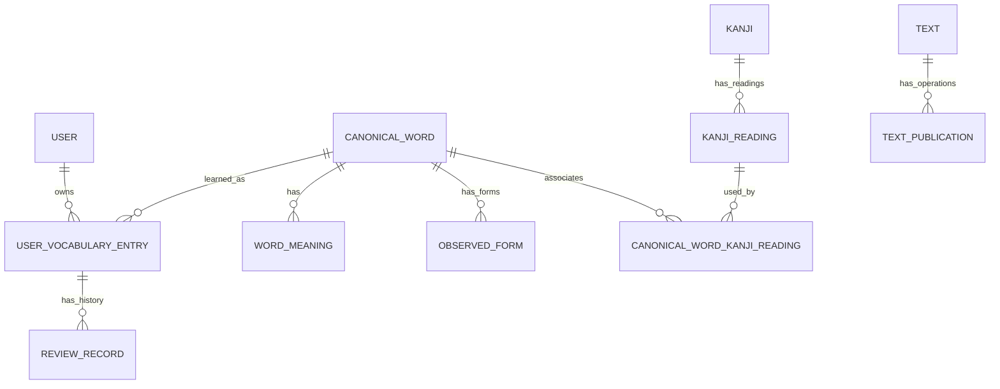

# Modelo de Dados — Japanese Learning Assistant MVP

**Versão:** 0.2  
**Status:** Modelo conceitual consolidado; ainda não é migração SQL executável  
**Banco:** PostgreSQL  
**Referência:** `Modules.md` e `Architectures.md`

## 1. Objetivo e escopo

Este documento formaliza as tabelas, chaves, restrições e relacionamentos definidos para o MVP. Ele é a referência para o desenho relacional e para futuras migrações SQL versionadas. Não é ainda um script de migração executável: detalhes de tipos, nomes SQL definitivos, índices e constraints deverão ser validados antes da primeira migração.

O modelo separa:

1. **Catálogo lexical global:** palavras canônicas, significados, formas observadas, kanji e leituras.
2. **Dados por usuário:** conta, vocabulário pessoal e histórico de revisões.
3. **Textos do Reader:** conteúdo original e estrutura linguística armazenada em `JSONB`.
4. **Operações de publicação:** registros duráveis usados para recuperar respostas perdidas sem duplicar publicações.

## 2. Convenções gerais

- Identificadores de entidades comuns usam `UUID`, gerado pelo banco por padrão.
- `text_id` é gerado pelo Reader; `processing_id` é gerado pelo Processing.
- Texto é armazenado em UTF-8. Para comparação e unicidade de texto japonês, a aplicação normaliza os valores para Unicode NFC antes de persistir.
- A normalização NFC deve ocorrer consistentemente antes da verificação de unicidade. PostgreSQL não deve ser tratado como se normalizasse automaticamente todo texto.
- E-mails são normalizados de forma consistente antes do armazenamento e possuem restrição de unicidade.
- Timestamps são `TIMESTAMPTZ`; timestamps de criação usam `DEFAULT CURRENT_TIMESTAMP` quando aplicável.
- Strings obrigatórias não podem ser vazias ou conter apenas espaços em branco. A validação deve existir na aplicação e, quando apropriado, em `CHECK` constraints.
- Restrições de chave estrangeira são restritivas por padrão. Não usar `ON DELETE CASCADE` indiscriminadamente.
- Migrações SQL são versionadas e constituem a fonte de verdade do esquema. Migrações já aplicadas não devem ser editadas; mudanças posteriores usam novos arquivos de migração.
- Dados de seed/teste são separados das migrações de estrutura.

## 3. Diagrama de relacionamentos

A relação `Text.processing_id` representa a operação mais recente que publicou com sucesso a versão atual. `TextPublication` preserva os resultados das operações anteriores para idempotência. A consistência entre `Text.processing_id` e a operação de publicação mais recente é mantida transacionalmente pela aplicação; não se cria uma FK circular entre essas duas tabelas.

## 4. Catálogo lexical global

### 4.1. `CanonicalWord`

Representa uma palavra lexical canônica global, compartilhada entre usuários e textos.

| Campo | Tipo conceitual | Regras |
|---|---|---|
| `word_id` | UUID | PK; gerado pelo banco |
| `canonical_form` | TEXT | Obrigatório; forma escrita canônica |
| `reading` | TEXT | Obrigatório; leitura da palavra completa |

**Unicidade:** combinação de `canonical_form` normalizado em NFC + `reading` normalizado em NFC. A mesma forma e a mesma leitura representam a mesma entrada; a mesma forma com leituras diferentes pode representar entradas distintas.

`word_id` é estável e usado como referência por outras tabelas. Uma correção de dados deve atualizar a entrada existente quando se tratar da mesma identidade lexical, não criar duplicatas automaticamente.

### 4.2. `WordMeaning`

Armazena um ou mais significados associados a uma palavra canônica.

| Campo | Tipo conceitual | Regras |
|---|---|---|
| `meaning_id` | UUID | PK |
| `word_id` | UUID | FK → `CanonicalWord.word_id`; obrigatório |
| `meaning_text` | TEXT | Obrigatório; não vazio |
| `display_order` | INTEGER | Obrigatório; define ordem de apresentação |

No MVP, os significados são em inglês; não há coluna de idioma neste estágio. Uma palavra canônica pode ter vários significados.

### 4.3. `ObservedForm`

Registra uma forma observada globalmente associada a uma palavra canônica. Não representa uma ocorrência específica em um texto: ocorrências são representadas dentro de `Text.elements`.

| Campo | Tipo conceitual | Regras |
|---|---|---|
| `observed_form_id` | UUID | PK |
| `word_id` | UUID | FK → `CanonicalWord.word_id`; obrigatório |
| `surface_form` | TEXT | Obrigatório; forma encontrada no texto |
| `reading` | TEXT | Obrigatório; leitura da forma observada |
| `grammatical_form` | TEXT | Informação gramatical; pode ser nula se indisponível |

**Unicidade:** combinação de `word_id` + `surface_form` NFC + `reading` NFC. A mesma forma observada associada à mesma palavra é reutilizada entre textos. Cada ocorrência textual permanece independente dentro do JSON do Reader.

`Text.elements` não precisa referenciar `ObservedForm` por ID no MVP. Uma ocorrência de palavra deve referenciar o `word_id` canônico quando resolvida e preservar a forma original observada.

### 4.4. `Kanji`

Representa um único caractere kanji.

| Campo | Tipo conceitual | Regras |
|---|---|---|
| `kanji_id` | UUID | PK |
| `character` | TEXT | Obrigatório; exatamente um caractere kanji após NFC |

**Unicidade:** `character` normalizado em NFC.

### 4.5. `KanjiReading`

Armazena uma leitura de um kanji.

| Campo | Tipo conceitual | Regras |
|---|---|---|
| `kanji_reading_id` | UUID | PK |
| `kanji_id` | UUID | FK → `Kanji.kanji_id`; obrigatório |
| `reading` | TEXT | Obrigatório |
| `reading_type` | TEXT | Obrigatório; `ON` ou `KUN` |

**Unicidade:** combinação de `kanji_id` + `reading` + `reading_type`.

### 4.6. `CanonicalWordKanjiReading`

Associa palavras canônicas a leituras de kanji relevantes para a palavra.

| Campo | Tipo conceitual | Regras |
|---|---|---|
| `word_id` | UUID | FK → `CanonicalWord.word_id`; parte da PK |
| `kanji_reading_id` | UUID | FK → `KanjiReading.kanji_reading_id`; parte da PK |

**Chave primária composta:** (`word_id`, `kanji_reading_id`). A associação não precisa de um identificador próprio.

Essa relação usa leituras de dicionário do kanji, não necessariamente a realização fonética exata dentro de uma palavra. A leitura completa da palavra permanece em `CanonicalWord.reading`. Por exemplo, a palavra `学校` pode ser associada às leituras de dicionário `がく` e `こう`; a pronúncia contextual `がっ` não precisa ser cadastrada como leitura separada do kanji.

O catálogo deve associar cada kanji presente na forma canônica a pelo menos uma leitura de kanji apropriada, de modo que os kanji associados possam ser derivados por `CanonicalWordKanjiReading → KanjiReading → Kanji`. Não criar uma tabela adicional `CanonicalWordKanji` no MVP.

## 5. Conta e progresso do usuário

### 5.1. `User`

| Campo | Tipo conceitual | Regras |
|---|---|---|
| `user_id` | UUID | PK; gerado pelo banco |
| `name` | TEXT | Obrigatório; não vazio |
| `email` | TEXT | Obrigatório; valor normalizado e único |
| `password_hash` | TEXT | Obrigatório; hash seguro, nunca senha em texto puro |
| `furigana_preference` | TEXT | Obrigatório; `SHOW` ou `HIDE` |
| `created_at` | TIMESTAMPTZ | Obrigatório; default `CURRENT_TIMESTAMP` |
| `updated_at` | TIMESTAMPTZ | Obrigatório; atualizado em alterações bem-sucedidas |

A autenticação do MVP é local. Senhas devem ser armazenadas com um algoritmo de hash adequado para senhas, como Argon2id. Verificação de e-mail e recuperação de senha ficam fora do escopo inicial.

A preferência global de furigana definida neste modelo é `SHOW` ou `HIDE`. Preferências manuais por palavra são um conceito de apresentação do Reader; a persistência específica dessas substituições por palavra ainda precisa ser formalizada antes de criar uma tabela própria.

### 5.2. `UserVocabularyEntry`

Representa a relação entre um usuário e uma palavra canônica. Combina a inclusão no vocabulário com o estado atual de aprendizagem.

| Campo | Tipo conceitual | Regras |
|---|---|---|
| `entry_id` | UUID | PK; gerado pelo banco |
| `user_id` | UUID | FK → `User.user_id`; obrigatório |
| `word_id` | UUID | FK → `CanonicalWord.word_id`; obrigatório |
| `entry_date` | TIMESTAMPTZ | Obrigatório; momento em que a palavra foi adicionada |
| `learning_state` | TEXT | `AWAITING_FIRST_REVIEW` ou `REVIEWED` |
| `knowledge_degree` | NUMERIC(5,2) | Obrigatório; intervalo de 0 a 100 |
| `last_review_at` | TIMESTAMPTZ | Nulo antes da primeira revisão real |
| `next_review_at` | TIMESTAMPTZ | Data prevista; pode ser nula conforme as regras atuais de agendamento |

**Unicidade:** (`user_id`, `word_id`). Um usuário não deve ter entradas duplicadas para a mesma palavra canônica.

**Consistência do estado:**

- `AWAITING_FIRST_REVIEW` exige `last_review_at IS NULL`.
- `REVIEWED` exige `last_review_at IS NOT NULL`.
- `knowledge_degree` deve estar entre 0 e 100.
- `NOT_STUDIED` não é armazenado como `learning_state`: significa que ainda não existe `UserVocabularyEntry` para a combinação de usuário e palavra.

Quando o usuário declara conhecer uma palavra, cria-se a entrada com um grau inicial alto, estado `AWAITING_FIRST_REVIEW`, `entry_date` preenchido e `last_review_at`/`next_review_at` nulos. Essa ação não cria `ReviewRecord`. A palavra deve ser elegível à próxima seleção de revisão por ainda não ter `next_review_at` definido. Os valores iniciais exatos e a regra de agendamento serão finalizados com a estratégia SRS.

### 5.3. `ReviewRecord`

Registra cada revisão real realizada para uma entrada de vocabulário.

| Campo | Tipo conceitual | Regras |
|---|---|---|
| `review_id` | UUID | PK; gerado pelo banco |
| `entry_id` | UUID | FK → `UserVocabularyEntry.entry_id`; obrigatório |
| `reviewed_at` | TIMESTAMPTZ | Obrigatório; instante da revisão real |
| `rating` | TEXT | `AGAIN`, `HARD`, `GOOD` ou `EASY` |
| `actual_interval` | INTERVAL | Tempo decorrido desde a revisão real anterior; nulo na primeira revisão |

`actual_interval` descreve o tempo efetivamente decorrido entre revisões, não o intervalo futuro planejado pelo algoritmo. `resulting_interval` não é armazenado porque depende da estratégia SRS.

A inserção de `ReviewRecord` e a atualização de `UserVocabularyEntry` devem ocorrer na mesma transação. O índice (`entry_id`, `reviewed_at DESC`) atende consultas do histórico por entrada e não exige outro índice separado apenas para `entry_id`.

## 6. Textos do Reader

### 6.1. `Text`

Armazena o texto publicado e sua estrutura linguística atual. O conteúdo original completo é autoritativo; Reader não deve reconstruí-lo concatenando segmentos.

| Campo | Tipo conceitual | Regras |
|---|---|---|
| `text_id` | UUID | PK; gerado pelo Reader |
| `processing_id` | UUID | Obrigatório; ID da operação que publicou com sucesso a versão atual |
| `original_content` | TEXT | Obrigatório; texto original completo, não vazio |
| `elements` | JSONB | Obrigatório; array ordenado de elementos estruturados |
| `version` | INTEGER | Obrigatório; começa em 1 e deve ser ≥ 1 |
| `created_at` | TIMESTAMPTZ | Obrigatório; default `CURRENT_TIMESTAMP` |
| `updated_at` | TIMESTAMPTZ | Obrigatório; atualizado somente quando uma nova versão é publicada |

O JSON `elements` pode conter parágrafos, frases, títulos, pontuação, segmentos de palavras, leituras, referências `canonicalWordId`, anotações gramaticais e outros elementos estruturais. O esquema interno completo ainda será definido e validado por Reader. Não são criadas tabelas independentes para ocorrências de palavras, frases ou parágrafos no MVP.

Cada ocorrência deve preservar a ordem e a substring original correspondente. A presença de `canonicalWordId` depende da resolução lexical; Reader pode aceitar elementos explicitamente não analisados se a estrutura e o conteúdo original forem preservados.

**Índices:** PK em `text_id` e índice regular em `processing_id`. Não criar índice GIN em `elements` até existir uma consulta concreta que o justifique.

### 6.2. `TextPublication`

Registra o resultado de cada operação de publicação bem-sucedida para permitir idempotência e recuperação quando uma resposta de Reader se perde.

| Campo | Tipo conceitual | Regras |
|---|---|---|
| `processing_id` | UUID | PK/único; identifica a operação lógica gerada por Processing |
| `text_id` | UUID | FK → `Text.text_id`; obrigatório |
| `operation` | TEXT | `PUBLISH` ou `REPLACE` |
| `request_fingerprint` | TEXT | Obrigatório; fingerprint estável do payload e da operação |
| `published_version` | INTEGER | Obrigatório; versão criada por essa operação |
| `created_at` | TIMESTAMPTZ | Obrigatório; momento da operação bem-sucedida |

A tabela registra operações concluídas com sucesso; registros não expiram automaticamente no MVP. `processing_id` é único para impedir que duas operações concorrentes com o mesmo ID publiquem duas vezes. O fingerprint é comparado em retries: mesma operação e mesmo payload retornam o resultado original; mesmo ID com payload/operação diferentes é rejeitado como `IDEMPOTENCY_KEY_REUSED`.

A publicação ou substituição de `Text` e a inserção de `TextPublication` devem ocorrer na mesma transação. A consulta do registro de idempotência deve preceder a validação de `expected_version` no retry, pois a versão já pode ter sido incrementada pela primeira execução.

`Text.processing_id` guarda apenas o ID da operação que publicou a versão atual. `TextPublication` preserva a associação de operações anteriores e permite devolver `text_id` e `published_version` originais em retries.

### 6.3. Regras de publicação e substituição

- `PUBLISH`: requisição sem `text_id`; Reader gera um novo `text_id` e cria a versão 1.
- `REPLACE`: requisição com `text_id` conhecido e `expected_version`; Reader preserva `text_id` e incrementa `version` somente após validação e persistência bem-sucedidas.
- Repetir a mesma operação com o mesmo `processing_id` e payload não cria texto, não altera conteúdo e não incrementa versão novamente.
- Falha de validação, falha de persistência ou conflito de versão não altera a versão publicada anteriormente.
- Cada nova operação lógica usa novo `processing_id`. Uma tentativa de rede repetida da mesma operação reutiliza o mesmo ID e payload.
- Processing não conhece `text_id` antes da primeira publicação. Se a resposta se perder, ele repete `PUBLISH` com o mesmo `processing_id` e recupera o `text_id` original pela resposta idempotente.

## 7. Relacionamentos e cardinalidades

| Origem | Relação | Destino | Cardinalidade / regra |
|---|---|---|---|
| `User` | vocabulário do usuário | `UserVocabularyEntry` | Um usuário pode ter zero ou muitas entradas; cada entrada pertence a um usuário |
| `CanonicalWord` | entrada de vocabulário | `UserVocabularyEntry` | Uma palavra pode estar no vocabulário de muitos usuários; combinação usuário/palavra é única |
| `UserVocabularyEntry` | histórico | `ReviewRecord` | Uma entrada pode ter zero ou muitas revisões; cada revisão pertence a uma entrada |
| `CanonicalWord` | significados | `WordMeaning` | Uma palavra pode ter vários significados |
| `CanonicalWord` | formas observadas | `ObservedForm` | Uma palavra pode ter várias formas observadas |
| `CanonicalWord` | leituras de kanji associadas | `CanonicalWordKanjiReading` | Relação muitos-para-muitos com `KanjiReading` |
| `Kanji` | leituras | `KanjiReading` | Um kanji pode ter várias leituras |
| `Text` | operações de publicação | `TextPublication` | Um texto pode ter várias operações de publicação ao longo do tempo; cada operação aponta para um texto |

## 8. Chaves estrangeiras e exclusão

Usar comportamento restritivo para as FKs do catálogo, usuários, progresso, histórico e publicação. Não remover automaticamente histórico de revisão ao excluir uma entrada de vocabulário, nem excluir palavras do catálogo que sejam referenciadas por entradas de usuário ou textos publicados.

A política futura de exclusão de conta deverá decidir explicitamente entre exclusão, anonimização e retenção permitida. Ela não deve ser inferida a partir de `ON DELETE CASCADE`.

## 9. Índices e unicidade

Índices e constraints necessários no primeiro esquema:

- PKs de todas as entidades.
- Unicidade de `User.email` após normalização.
- Unicidade de `CanonicalWord(canonical_form, reading)` após NFC.
- Unicidade de `ObservedForm(word_id, surface_form, reading)` após NFC.
- Unicidade de `Kanji.character` após NFC.
- Unicidade de `KanjiReading(kanji_id, reading, reading_type)`.
- PK composta de `CanonicalWordKanjiReading(word_id, kanji_reading_id)`.
- Unicidade de `UserVocabularyEntry(user_id, word_id)`.
- Índice de `ReviewRecord(entry_id, reviewed_at DESC)`.
- Índice de `Text(processing_id)`.
- Unicidade/PK de `TextPublication.processing_id` e FK de `TextPublication.text_id`.

Adicionar índice de seleção de revisões vencidas somente depois de definir e validar a consulta real do SRS. Não indexar `Text.elements` com GIN até existir uma necessidade concreta.

## 10. Decisões adiadas

- Esquema detalhado de `Text.elements` e validação de cada tipo de elemento.
- Persistência das preferências manuais de furigana por palavra, além da preferência global registrada em `User`.
- Algoritmo SRS e valores iniciais exatos para palavras declaradas conhecidas.
- Regras definitivas de `next_review_at` para entradas `REVIEWED`.
- ORM/query layer da aplicação NestJS.
- Política de exclusão/anonymização de conta.
- Índices adicionais baseados em consultas reais.

Esses pontos não invalidam as relações principais definidas aqui; devem ser resolvidos antes de criar as migrações SQL correspondentes.

---

## 11. Complemento consolidado — identidade e idempotência

Esta seção formaliza a distinção entre o texto persistido e a operação que o publicou. Ela prevalece sobre qualquer interpretação de que Processing gera ou conhece `text_id` antes da publicação inicial.

### 11.1. `Text` e `TextPublication`

- Reader gera `Text.text_id`. Processing não envia `text_id` para uma publicação inicial.
- Processing gera `processing_id` no início de cada operação lógica.
- `Text.processing_id` contém somente o `processing_id` que publicou com sucesso a versão atualmente armazenada.
- `TextPublication` mantém o resultado de cada operação de publicação bem-sucedida, incluindo operações antigas, para reconhecer retries após substituições posteriores.
- O registro de `Text` e o registro de `TextPublication` para uma publicação bem-sucedida são gravados na mesma transação.

### 11.2. Publicação e substituição

| Operação | `text_id` na requisição | `expected_version` | Resultado |
|---|---|---|---|
| `PUBLISH` inicial | Ausente | Nulo | Reader gera `text_id`; versão 1 |
| Retry de `PUBLISH` já concluído | Ausente, como no pedido original | Mesmo valor original | Reader retorna `text_id` e versão originais; não duplica |
| `REPLACE` | Presente e conhecido por Processing | Versão atual esperada | Mantém `text_id`; incrementa versão após sucesso |
| Retry de `REPLACE` já concluído | Mesmo `text_id` do pedido original | Mesmo valor original | Retorna o resultado original sem incrementar de novo |

Cada nova operação lógica usa um novo `processing_id`. Retries reutilizam o mesmo `processing_id` e o mesmo payload. Reader rejeita reutilização do mesmo ID com payload ou tipo de operação diferente.

### 11.3. Fingerprint do pedido

`request_fingerprint` deve ser calculado sobre uma representação canônica e estável dos campos relevantes à operação, incluindo o tipo de operação, `text_id` quando presente, `expected_version` e o payload do documento. A serialização usada para gerar o fingerprint deve ser determinística. O algoritmo de hash concreto será escolhido durante a implementação.

### 11.4. Concorrência e recuperação

A unicidade de `TextPublication.processing_id` deve ser garantida no banco. Duas requisições concorrentes com o mesmo ID não podem publicar duas vezes. Em um retry, Reader consulta o registro idempotente antes de validar a versão esperada, pois a primeira execução pode já ter incrementado a versão.

Se Processing não receber a resposta, ele registra o resultado como desconhecido usando `processing_id`, sem inventar `text_id`. Reenvia a mesma operação para recuperar o resultado original. Registros idempotentes não expiram automaticamente no MVP.

## 12. Relação entre o modelo e as migrações

Este documento é a especificação de referência, não o SQL final. Antes da primeira migração, devem ser definidos e validados: nomes SQL definitivos, constraints de texto não vazio, implementação de unicidade sobre valores NFC-normalizados, defaults de UUID, enums via `TEXT` + `CHECK`, política de `next_review_at`, schema JSON de `Text.elements` e o fingerprint canônico da publicação. As migrações devem ser versionadas e não podem ser alteradas após aplicação em um ambiente compartilhado; correções usam uma nova migração.
